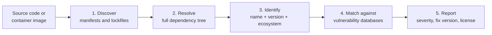
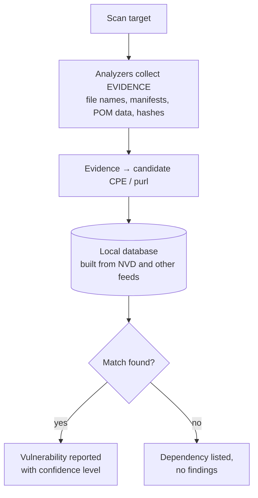
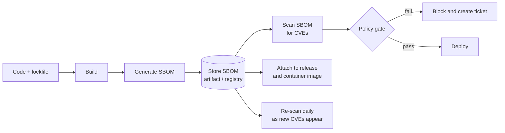
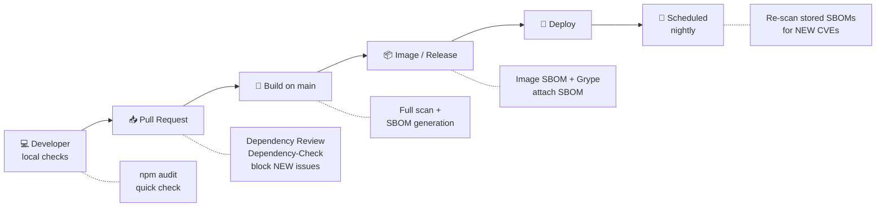
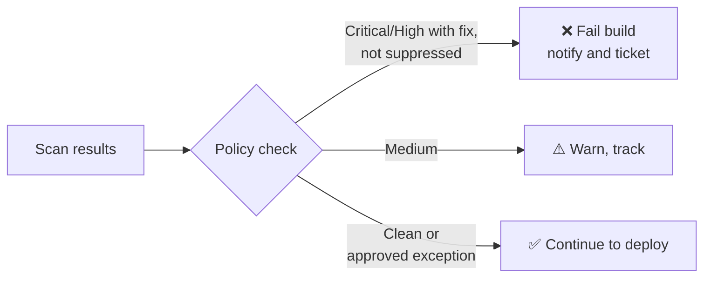
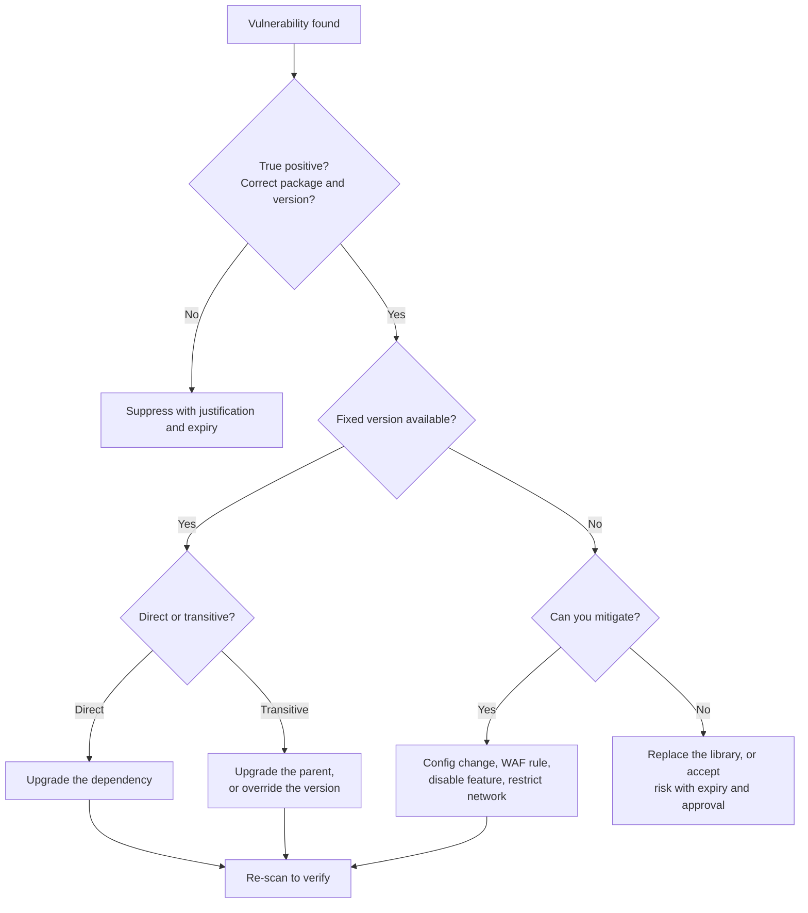

# Module 05: Software Composition Analysis (SCA) and SBOM 🧩

## 📌 Overview

Software Composition Analysis (SCA) identifies the **open-source and third-party components** in your application and checks them for known vulnerabilities and license risks.

A **Software Bill of Materials (SBOM)** is a machine-readable inventory of everything inside your software. Together, SCA and SBOM answer two questions every team must be able to answer quickly: **"What is in our software?"** and **"Is any of it vulnerable?"**

In this module, we will use **OWASP Dependency-Check** to find vulnerable dependencies, **Syft** to generate SBOMs, **Grype** to scan them, and **Dependabot** to automate fixes. Then we will wire everything into CI/CD with security gates.

> [!NOTE]
> This module builds on [Module 04](../04-static-application-security-testing-sast/README.md). There you learned to find insecure code **you wrote**. Here you learn to find vulnerable code **you imported**. Module 03 ([Git, GitHub and Secret Security](../03-git-github-and-secret-security/README.md)) gave you the GitHub and pipeline foundations used again here.

> [!IMPORTANT]
> **Lab environment:** You need **Docker**, **Git**, **Node.js 18+ with npm**, **jq**, a **GitHub account**, and a terminal. Linux, macOS, or Windows with WSL2 all work. Request a **free NVD API key** before you start: <https://nvd.nist.gov/developers/request-an-api-key>. The lab application in this module is **intentionally vulnerable**. Scan it, but **never run it on a public network or deploy it**.

## 🎯 Learning Objectives

By the end of this module, you will be able to:

- Understand SCA and its role in DevSecOps.
- Differentiate direct and transitive dependencies and trace a vulnerable package to its origin.
- Read a CVE record and interpret CVSS scores and vectors.
- Scan a project with OWASP Dependency-Check and triage the report.
- Explain what an SBOM is and compare the SPDX and CycloneDX formats.
- Generate SBOMs with Syft and scan them with Grype.
- Configure Dependabot alerts, security updates, and version updates.
- Integrate SCA and SBOM generation into GitHub Actions and Jenkins pipelines.
- Enforce security gates and remediate, suppress, or accept vulnerabilities correctly.

## 📚 Table of Contents

1. [What Is SCA?](#1-what-is-sca)
2. [Direct vs. Transitive Dependencies](#2-direct-vs-transitive-dependencies)
3. [Understanding CVE and CVSS](#3-understanding-cve-and-cvss)
4. [Introduction to OWASP Dependency-Check](#4-introduction-to-owasp-dependency-check)
5. [Scanning Dependencies with Dependency-Check](#5-scanning-dependencies-with-dependency-check)
6. [Introduction to SBOM](#6-introduction-to-sbom)
7. [SBOM Formats: SPDX vs. CycloneDX](#7-sbom-formats-spdx-vs-cyclonedx)
8. [Generating an SBOM with Syft](#8-generating-an-sbom-with-syft)
9. [Understanding Dependabot](#9-understanding-dependabot)
10. [Integrating SCA into CI/CD](#10-integrating-sca-into-cicd)
11. [Security Gates and Vulnerability Remediation](#11-security-gates-and-vulnerability-remediation)
12. [Hands-on Labs](#12-hands-on-labs)
13. [Best Practices](#13-best-practices)
14. [Troubleshooting](#14-troubleshooting)
15. [Interview Questions](#15-interview-questions)
16. [References](#16-references)

---

## 1. What Is SCA?

### 1.1 Definition

**Software Composition Analysis (SCA)** is the automated process of identifying the open-source and third-party components in your software, then checking them against databases of known vulnerabilities, license terms, and sometimes operational risk (such as abandoned or malicious packages).

> [!TIP]
> **In one sentence:** SAST checks the code *you wrote*. SCA checks the code *you imported*.

### 1.2 Why SCA Matters: Real Incidents

| Incident | Year | What happened | Lesson |
| :--- | :---: | :--- | :--- |
| **Equifax** (Apache Struts, CVE-2017-5638) | 2017 | A known, already-patched flaw in a web framework stayed unpatched. Roughly 147 million people's data was exposed. | A fix existed. Nobody knew they were running the vulnerable version. |
| **event-stream** (npm) | 2018 | An attacker took over a popular package and added code targeting a specific crypto wallet. | Trust in a maintainer is not permanent. |
| **SolarWinds Orion** | 2020 | Attackers compromised the *build process* and shipped a backdoor to thousands of customers. | Supply chain risk goes beyond CVEs. |
| **Log4Shell** (Log4j, CVE-2021-44228) | 2021 | Remote code execution in a ubiquitous Java logging library. CVSS 10.0. | Most teams could not answer "are we affected?" quickly. **This is the problem SBOMs solve.** |
| **xz-utils backdoor** (CVE-2024-3094) | 2024 | A long-term social-engineering campaign planted a backdoor in a core compression library. | Even deep, "boring" dependencies are targets. |

This risk is tracked by the **OWASP Top 10**: *A06:2021 – Vulnerable and Outdated Components*, which the 2025 edition broadens into *Software Supply Chain Failures*.

### 1.3 How SCA Tools Work



1. **Discover:** find `package.json`, `pom.xml`, `requirements.txt`, `go.mod`, JARs, OS packages, and so on.
2. **Resolve:** build the complete tree, including transitive dependencies.
3. **Identify:** map each component to a standard identifier (a CPE or a **purl**, covered in Section 6).
4. **Match:** compare against the **NVD**, **GitHub Advisory Database**, **OSV**, and vendor feeds.
5. **Report:** list vulnerabilities, severity, and (ideally) the version that fixes them.

### 1.4 Limitations You Should Know

- SCA only finds **known** vulnerabilities (those with a published CVE or advisory). Zero-days are invisible to it.
- A vulnerable library does **not always** mean an exploitable application. If you never call the vulnerable function, real risk is lower. This is called **reachability**, and most basic scanners do not analyze it.
- Identification can be wrong. Matching a library to a CPE is heuristic for some ecosystems, which produces **false positives** and **false negatives**.

---

## 2. Direct vs. Transitive Dependencies

### 2.1 The Concept

- **Direct dependency:** a package you explicitly declare (in `package.json`, `pom.xml`, `requirements.txt`).
- **Transitive dependency:** a package pulled in *by your dependencies*. You never asked for it, but you ship it.

```text
your-app
├── express@4.17.1            ← DIRECT (you declared it)
│   ├── body-parser@1.19.0    ← TRANSITIVE (depth 2)
│   │   └── qs@6.7.0          ← TRANSITIVE (depth 3)  ⚠️ vulnerable
│   ├── path-to-regexp@0.1.7  ← TRANSITIVE (depth 2)  ⚠️ vulnerable
│   └── cookie@0.4.0          ← TRANSITIVE (depth 2)
└── lodash@4.17.15            ← DIRECT                ⚠️ vulnerable
```

> [!IMPORTANT]
> A typical project declares 10 to 30 direct dependencies and ends up with **hundreds** of transitive ones. Most vulnerabilities you will find are transitive, and you cannot fix them just by editing your own dependency list.

### 2.2 Manifests vs. Lockfiles

| Ecosystem | Manifest (what you want) | Lockfile (exactly what you got) | Tree command |
| :--- | :--- | :--- | :--- |
| Node.js (npm) | `package.json` | `package-lock.json` | `npm ls --all` |
| Java (Maven) | `pom.xml` | none (use the dependency plugin) | `mvn dependency:tree` |
| Java (Gradle) | `build.gradle` | `gradle.lockfile` | `gradle dependencies` |
| Python (pip) | `requirements.txt` | `pip freeze` output, `poetry.lock` | `pipdeptree` |
| Go | `go.mod` | `go.sum` | `go mod graph` |
| Ruby | `Gemfile` | `Gemfile.lock` | `bundle list` |

> [!WARNING]
> **Always commit your lockfile.** Without it, two builds on different days can resolve different transitive versions, so your scan will not match what you shipped. SCA tools are also more accurate when a lockfile is present.

### 2.3 Tracing a Vulnerable Transitive Dependency

When a scanner says `qs@6.7.0` is vulnerable, you need to answer: **who brought it in?**

```bash
# npm: why is this package installed?
npm ls qs
npm explain qs

# Maven
mvn dependency:tree -Dincludes=org.apache.logging.log4j

# Python (reverse tree: who depends on urllib3?)
pipdeptree -r -p urllib3
```

Example `npm ls qs` output:

```text
vulnerable-demo-app@1.0.0
└─┬ express@4.17.1
  ├─┬ body-parser@1.19.0
  │ └── qs@6.7.0
  └── qs@6.7.0 deduped
```

This tells you the fix path: **upgrade `express`**, the direct parent, to a version that depends on a patched `qs`.

### 2.4 Dependency-Related Attacks

| Attack | How it works | Defense |
| :--- | :--- | :--- |
| **Typosquatting** | Malicious package named `lodahs` instead of `lodash` | Review new dependencies, use allow-lists |
| **Dependency confusion** | Attacker publishes a public package with the same name as your private one, at a higher version | Use scoped packages and registry pinning |
| **Maintainer takeover** | A compromised account pushes a malicious update | Pin versions, use lockfiles, review updates |
| **Abandoned packages** | Unmaintained code never gets security fixes | Track package health, replace dead dependencies |

---

## 3. Understanding CVE and CVSS

### 3.1 CVE: Common Vulnerabilities and Exposures

A **CVE** is a unique ID for a publicly disclosed vulnerability, so everyone (vendors, scanners, defenders) can refer to the same flaw.

```text
CVE-2021-44228
 │    │     └── Sequence number
 │    └──────── Year the ID was assigned
 └───────────── Prefix
```

| Source | What it adds |
| :--- | :--- |
| [CVE.org](https://www.cve.org/) | The official CVE list (ID and description) |
| [NVD](https://nvd.nist.gov/) (NIST) | Enriched CVEs: CVSS scores, CWE, affected products (CPE) |
| [GitHub Advisory Database](https://github.com/advisories) | Package-ecosystem advisories with fixed versions (used by Dependabot) |
| [OSV.dev](https://osv.dev) | Open, machine-friendly vulnerability database organized by ecosystem |

**Lifecycle:** discovery → responsible disclosure → CVE ID assigned → fix released → advisory published → NVD enrichment → scanners pick it up.

> [!NOTE]
> **CWE** classifies the *type* of weakness (for example CWE-502, Deserialization of Untrusted Data). **CPE** identifies the affected *product and version*. A CVE is one specific instance of a weakness in one product.

### 3.2 CVSS: Common Vulnerability Scoring System

**CVSS** scores a vulnerability from **0.0 to 10.0** to describe its *technical severity*.

| Score | Severity |
| :---: | :--- |
| 0.0 | None |
| 0.1 – 3.9 | 🟢 Low |
| 4.0 – 6.9 | 🟡 Medium |
| 7.0 – 8.9 | 🟠 High |
| 9.0 – 10.0 | 🔴 Critical |

**Base metrics (CVSS v3.1):**

| Metric | Abbrev. | Values | Question it answers |
| :--- | :---: | :--- | :--- |
| Attack Vector | AV | Network / Adjacent / Local / Physical | How close must the attacker be? |
| Attack Complexity | AC | Low / High | Does exploitation need special conditions? |
| Privileges Required | PR | None / Low / High | Must the attacker be logged in? |
| User Interaction | UI | None / Required | Must a victim click something? |
| Scope | S | Unchanged / Changed | Can it affect resources beyond the vulnerable component? |
| Confidentiality | C | None / Low / High | Data disclosure impact |
| Integrity | I | None / Low / High | Data modification impact |
| Availability | A | None / Low / High | Service disruption impact |

**Reading a vector string (Log4Shell):**

```text
CVSS:3.1/AV:N/AC:L/PR:N/UI:N/S:C/C:H/I:H/A:H   →   10.0 Critical
         │    │    │    │    │   │   │   │
         │    │    │    │    │   │   │   └─ Availability: High
         │    │    │    │    │   │   └───── Integrity: High
         │    │    │    │    │   └───────── Confidentiality: High
         │    │    │    │    └───────────── Scope: Changed
         │    │    │    └────────────────── User interaction: None
         │    │    └─────────────────────── Privileges: None
         │    └──────────────────────────── Complexity: Low
         └───────────────────────────────── Vector: Network (remote)
```

In plain English: *anyone on the internet, with no account and no victim interaction, can easily take full control.* That is why it scored 10.0.

> [!NOTE]
> CVSS **v4.0** was released in 2023 and is gradually appearing in advisories. Most tools today still show v3.x scores. The concepts carry over.

### 3.3 CVSS Is Not Risk

CVSS measures **severity**, not **risk to you**. Two critical CVEs are not equally urgent. Add context:

| Signal | What it tells you | Where to get it |
| :--- | :--- | :--- |
| **EPSS** | Probability (0 to 1) the CVE will be exploited in the next 30 days | [first.org/epss](https://www.first.org/epss/) |
| **CISA KEV** | CVEs **confirmed exploited in the wild**. Fix these first. | [CISA KEV catalog](https://www.cisa.gov/known-exploited-vulnerabilities-catalog) |
| **Reachability** | Does your code actually call the vulnerable function? | Code review, advanced SCA tools |
| **Exposure** | Is the component internet-facing or internal-only? | Architecture knowledge |
| **Fix availability** | Is there a patched version? | Advisory or scanner output |
| **VEX** | A supplier statement that a CVE is *not exploitable* in their product | CycloneDX, OpenVEX, CSAF |

**A practical priority order:**

```text
1. In CISA KEV (actively exploited)                     → fix immediately
2. High EPSS + Critical/High CVSS + internet-facing     → fix this sprint
3. Critical/High CVSS, fix available, reachable         → fix per SLA
4. Medium/Low, or not reachable / not exposed           → backlog, or suppress with justification
```

---

## 4. Introduction to OWASP Dependency-Check

### 4.1 What It Is

**OWASP Dependency-Check (ODC)** is a free, open-source SCA tool. It scans project dependencies and reports those with publicly known vulnerabilities.

### 4.2 How It Works



- **Evidence-based identification:** ODC gathers clues (vendor, product, version) and infers a CPE. Because this is inference, results carry **confidence levels** (Low, Medium, High, Highest), and false positives happen.
- **Local database:** ODC downloads vulnerability data once and scans against it locally. The **first run is slow**, later runs only fetch updates.
- **NVD API key:** the NVD rate-limits its API heavily. Use a key (`--nvdApiKey`) or updates will be very slow or fail.

### 4.3 Supported Ecosystems

| Maturity | Ecosystems |
| :--- | :--- |
| **Strong** | Java (JAR, Maven, Gradle), .NET (assemblies, NuGet), JavaScript (npm, via lockfile and Node Audit) |
| **Good** | Python, Ruby, PHP (Composer) |
| **Experimental** (needs `--enableExperimental`) | Go modules, CocoaPods, Swift, others |

### 4.4 Ways to Run It

| Method | Best for |
| :--- | :--- |
| **Docker image** (`owasp/dependency-check`) | Local use and CI with no installation. *Used in this module.* |
| **CLI** (zip download) | Local use without Docker |
| **Maven / Gradle plugin** | Java teams, build-integrated |
| **Jenkins plugin** | Jenkins pipelines with trend graphs |
| **GitHub Action** | Simple GitHub workflows |

### 4.5 Important CLI Options

| Option | Purpose |
| :--- | :--- |
| `--scan <path>` | File or folder to scan (repeatable) |
| `--project <name>` | Project name shown in the report |
| `--format <fmt>` | `HTML`, `JSON`, `XML`, `CSV`, `JUNIT`, `SARIF`, `JENKINS`, `GITLAB`, `ALL` |
| `--out <dir>` | Where to write reports |
| `--nvdApiKey <key>` | NVD API key (strongly recommended) |
| `--failOnCVSS <score>` | Exit with code **1** if any finding has CVSS ≥ score |
| `--suppression <file>` | XML file listing accepted false positives or risks |
| `--data <dir>` | Persistent database location (cache it) |
| `--noupdate` | Skip database update (offline or cached runs) |
| `--exclude <pattern>` | Ignore paths (for example `**/node_modules/**`) |
| `--disableNodeAudit` | Skip the Node Audit analyzer if it fails in your network |
| `--enableExperimental` | Turn on experimental analyzers |

---

## 5. Scanning Dependencies with Dependency-Check

### 5.1 The Standard Docker Command

```bash
# Run from your project root
export NVD_API_KEY="paste-your-key-here"
mkdir -p odc-data reports

docker run --rm \
  -v "$(pwd)":/src \
  -v "$(pwd)/odc-data":/usr/share/dependency-check/data \
  -v "$(pwd)/reports":/report \
  owasp/dependency-check:latest \
  --scan /src \
  --project "vulnerable-demo-app" \
  --format HTML --format JSON \
  --out /report \
  --nvdApiKey "$NVD_API_KEY"
```

| Piece | Meaning |
| :--- | :--- |
| `-v "$(pwd)":/src` | Mounts your project into the container as `/src` |
| `-v .../odc-data:/usr/share/dependency-check/data` | **Persists the vulnerability database** so it is not re-downloaded every run |
| `-v .../reports:/report` | Gets reports back onto your machine |
| `--scan /src` | What to analyze |
| `--format HTML --format JSON` | HTML for humans, JSON for automation |

> [!NOTE]
> **First run:** with an API key, expect several minutes. Without one, it can take hours. Later runs take seconds to a couple of minutes because only updates are fetched.
>
> **Windows PowerShell:** replace `$(pwd)` with `${PWD}` and the line-continuation `\` with a backtick.

### 5.2 Reading the HTML Report

Open `reports/dependency-check-report.html` in a browser.

| Column | What it means |
| :--- | :--- |
| **Dependency** | The file or package scanned |
| **Vulnerability IDs** | CVEs and advisories matched |
| **Package** | Identified purl/CPE (for example `pkg:npm/lodash@4.17.15`) |
| **Highest Severity** | Worst severity among its CVEs |
| **CVE Count** | Number of vulnerabilities |
| **Confidence** | How sure ODC is about the *identification* (not the vulnerability) |
| **Evidence Count** | How many clues supported the match |

**How to triage a finding:**

1. **Is the identification correct?** Check the package and version. Low confidence plus an odd CPE often means a false positive.
2. **Open the CVE.** Read the description and vector. Does it apply to *how you use* the library?
3. **Is a fixed version listed?** The report usually says "versions up to X are affected."
4. **Trace the origin** (`npm ls`, `mvn dependency:tree`). Direct or transitive?
5. **Decide:** fix, mitigate, suppress (with justification), or accept (with expiry).

### 5.3 Reading the JSON Report with jq

```bash
# Total dependencies vs. how many have vulnerabilities
jq '{total: (.dependencies | length),
     vulnerable: ([.dependencies[] | select(.vulnerabilities != null)] | length)}' \
   reports/dependency-check-report.json

# List package, CVE, and severity
jq -r '.dependencies[]
       | select(.vulnerabilities != null)
       | .fileName as $f
       | .vulnerabilities[]
       | [$f, .name, .severity] | @tsv' \
   reports/dependency-check-report.json | sort -u | head -30
```

### 5.4 Failing on a Threshold

```bash
docker run --rm \
  -v "$(pwd)":/src \
  -v "$(pwd)/odc-data":/usr/share/dependency-check/data \
  -v "$(pwd)/reports":/report \
  owasp/dependency-check:latest \
  --scan /src --format HTML --out /report \
  --nvdApiKey "$NVD_API_KEY" \
  --failOnCVSS 7

echo "Exit code: $?"      # 1 if any finding has CVSS >= 7, otherwise 0
```

That exit code is what makes the tool usable as a **pipeline gate** (Section 11).

### 5.5 Suppressing False Positives

Create `dependency-check-suppressions.xml`:

```xml
<?xml version="1.0" encoding="UTF-8"?>
<suppressions xmlns="https://jeremylong.github.io/DependencyCheck/dependency-suppression.1.3.xsd">

  <!-- Suppress ONE CVE for ONE package, with a reason and an expiry -->
  <suppress until="2026-12-31Z">
    <notes><![CDATA[
      CVE-2020-8203 affects lodash zipObjectDeep(). We never call it.
      Reviewed by: <your-name>, ticket SEC-123.
      Re-evaluate by 2026-12-31.
    ]]></notes>
    <packageUrl regex="true">^pkg:npm/lodash@4\.17\.15$</packageUrl>
    <cve>CVE-2020-8203</cve>
  </suppress>

</suppressions>
```

Then add `--suppression /src/dependency-check-suppressions.xml` to the scan command. You can also click **suppress** next to a finding in the HTML report to copy a ready-made XML snippet.

> [!WARNING]
> **Suppression rules:**
> - Suppress **one CVE on one package**, never "everything for this library."
> - Always include **who, why, and a ticket reference** in `<notes>`.
> - Always set an **`until` date** so suppressions are re-reviewed.
> - Review suppression files in code review like any other security-relevant change.

---

## 6. Introduction to SBOM

### 6.1 What Is an SBOM?

A **Software Bill of Materials (SBOM)** is a formal, machine-readable inventory of every component in a piece of software, including names, versions, suppliers, and relationships between them.

> [!TIP]
> **Analogy:** an ingredients label on food. You cannot know whether you are allergic to something unless the label lists it.

### 6.2 SBOM vs. SCA Scan

| | **SBOM** | **SCA scan** |
| :--- | :--- | :--- |
| **Is a...** | An *inventory* (a document) | An *analysis* (a process) |
| **Answers** | "What is in this software?" | "Which of those components are vulnerable?" |
| **Changes when...** | The software's contents change | New CVEs are published, even if the software did not change |
| **Shelf life** | Valid for one specific build | Results go stale within days |

The power move: **generate the SBOM once at build time, then re-scan that stored SBOM whenever new CVEs are published**, with no rebuild.

### 6.3 Why SBOMs Matter

- **Incident response:** when the next Log4Shell hits, search your SBOM archive and know *in minutes* which products are affected.
- **Regulation and procurement:** US **Executive Order 14028** (2021) pushed SBOMs into federal software purchasing. The EU **Cyber Resilience Act** brings similar obligations for products sold in the EU. Many enterprise customers now require SBOMs in contracts.
- **License compliance:** know exactly which licenses (GPL, MIT, Apache-2.0) you ship.
- **Transparency:** customers and auditors can verify what you deliver.

### 6.4 NTIA Minimum Elements

| # | Element | Example |
| :---: | :--- | :--- |
| 1 | **Supplier name** | Apache Software Foundation |
| 2 | **Component name** | log4j-core |
| 3 | **Version** | 2.14.1 |
| 4 | **Other unique identifiers** | `pkg:maven/org.apache.logging.log4j/log4j-core@2.14.1` |
| 5 | **Dependency relationship** | "my-app depends on log4j-core" |
| 6 | **Author of SBOM data** | Syft |
| 7 | **Timestamp** | 2026-10-25T10:00:00Z |

### 6.5 Package URL (purl)

A **purl** gives every component a consistent, ecosystem-aware name so tools agree on what they are describing.

```text
pkg:npm/lodash@4.17.15
pkg:maven/org.apache.logging.log4j/log4j-core@2.14.1
pkg:pypi/requests@2.31.0
pkg:golang/github.com/gin-gonic/gin@v1.9.1
pkg:deb/debian/openssl@3.0.11-1?arch=amd64
```

Structure: `pkg:` **type** `/` **namespace** `/` **name** `@` **version** `?` **qualifiers**

### 6.6 Types of SBOMs (CISA)

| Type | Generated from | Typical use |
| :--- | :--- | :--- |
| **Source** | Source code and manifests | Early in development |
| **Build** | The build process | Most accurate for what you compiled |
| **Analyzed** | Inspecting built artifacts | Third-party software you did not build |
| **Deployed** | A running or installed system | Runtime inventory |

### 6.7 SBOM Lifecycle in a Pipeline



---

## 7. SBOM Formats: SPDX vs. CycloneDX

Two formats dominate. Both are open standards, machine-readable, and accepted by most tools.

### 7.1 Side-by-Side

| | **SPDX** | **CycloneDX** |
| :--- | :--- | :--- |
| **Steward** | Linux Foundation | OWASP Foundation |
| **Standard status** | ISO/IEC 5962:2021 | ECMA-424 |
| **Origin and strength** | License compliance and provenance | Security and vulnerability management |
| **File formats** | JSON, YAML, XML, RDF, tag-value | JSON, XML, Protocol Buffers |
| **Vulnerability data / VEX** | Via related specifications | Built in |
| **Other BOM types** | Profiles for AI, data, and more | SBOM, SaaSBOM, HBOM, CBOM, ML-BOM |
| **Typical size** | Larger, more verbose | Leaner |
| **Typical audience** | Legal, compliance, government | AppSec, DevSecOps |

### 7.2 Which Should You Choose?

- **Security-driven pipeline, vulnerability scanning, VEX?** → **CycloneDX**
- **Legal or compliance requirement, or a customer or government mandate for an ISO standard?** → **SPDX**
- **Not sure?** → **Generate both.** Syft makes this trivial (Section 8). Store both, scan one.

### 7.3 What They Look Like

**CycloneDX (JSON), abbreviated:**

```json
{
  "bomFormat": "CycloneDX",
  "specVersion": "1.6",
  "serialNumber": "urn:uuid:3e671687-395b-41f5-a30f-a58921a69b79",
  "version": 1,
  "metadata": {
    "timestamp": "2026-10-25T10:00:00Z",
    "tools": { "components": [{ "type": "application", "name": "syft" }] },
    "component": { "type": "application", "name": "vulnerable-demo-app" }
  },
  "components": [
    {
      "type": "library",
      "name": "lodash",
      "version": "4.17.15",
      "purl": "pkg:npm/lodash@4.17.15",
      "licenses": [{ "license": { "id": "MIT" } }]
    }
  ]
}
```

**SPDX (JSON), abbreviated:**

```json
{
  "spdxVersion": "SPDX-2.3",
  "dataLicense": "CC0-1.0",
  "SPDXID": "SPDXRef-DOCUMENT",
  "name": "vulnerable-demo-app",
  "documentNamespace": "https://example.com/spdx/vulnerable-demo-app-1234",
  "creationInfo": {
    "created": "2026-10-25T10:00:00Z",
    "creators": ["Tool: syft"]
  },
  "packages": [
    {
      "SPDXID": "SPDXRef-Package-npm-lodash",
      "name": "lodash",
      "versionInfo": "4.17.15",
      "licenseConcluded": "MIT",
      "externalRefs": [
        {
          "referenceCategory": "PACKAGE-MANAGER",
          "referenceType": "purl",
          "referenceLocator": "pkg:npm/lodash@4.17.15"
        }
      ]
    }
  ],
  "relationships": [
    {
      "spdxElementId": "SPDXRef-DOCUMENT",
      "relationshipType": "DESCRIBES",
      "relatedSpdxElement": "SPDXRef-Package-npm-lodash"
    }
  ]
}
```

> [!NOTE]
> Same facts, different vocabulary. CycloneDX uses `components`. SPDX uses `packages` plus an explicit `relationships` list.

---

## 8. Generating an SBOM with Syft

### 8.1 What Are Syft and Grype?

**Syft** (by Anchore) is a fast, open-source CLI that generates SBOMs from **container images, filesystems, and directories**. Its companion **Grype** scans those SBOMs for vulnerabilities.

Syft catalogs npm, Python, Java, Go, Rust, Ruby, PHP, and .NET packages, plus OS packages (apk, deb, rpm).

> [!NOTE]
> You will use Syft again in [Module 07](../07-docker-and-container-security/README.md) alongside Trivy and Cosign to secure container images.

### 8.2 Installation

```bash
# macOS / Linux (Homebrew)
brew install syft grype

# Linux / macOS (install script)
curl -sSfL https://raw.githubusercontent.com/anchore/syft/main/install.sh | sh -s -- -b /usr/local/bin
curl -sSfL https://raw.githubusercontent.com/anchore/grype/main/install.sh | sh -s -- -b /usr/local/bin

# Windows
scoop install syft grype

# Or no install at all
docker run --rm anchore/syft:latest --version
```

Verify:

```bash
syft version
grype version
```

> [!WARNING]
> Piping a script into `sh` is convenient but trusts the network. In production, download a pinned release and verify its checksum.

### 8.3 Basic Usage

```bash
# Scan a directory (source SBOM)
syft dir:.

# Scan a container image
syft node:18-alpine

# Scan an image tarball
syft docker-archive:image.tar

# Scan a single file (for example a JAR)
syft file:./app.jar
```

Source prefixes: `dir:`, `file:`, `docker:`, `podman:`, `registry:`, `docker-archive:`, `oci-archive:`, `oci-dir:`.

### 8.4 Output Formats

```bash
# Human-readable table (default)
syft dir:. -o table

# CycloneDX JSON
syft dir:. -o cyclonedx-json=sboms/sbom.cdx.json

# SPDX JSON
syft dir:. -o spdx-json=sboms/sbom.spdx.json

# Multiple formats in ONE pass
syft dir:. \
  -o cyclonedx-json=sboms/sbom.cdx.json \
  -o spdx-json=sboms/sbom.spdx.json \
  -o syft-json=sboms/sbom.syft.json
```

| Format flag | Output |
| :--- | :--- |
| `table` | Human-readable list |
| `cyclonedx-json`, `cyclonedx-xml` | CycloneDX |
| `spdx-json`, `spdx-tag-value` | SPDX |
| `syft-json` | Syft's native format (most detailed) |
| `github-json` | GitHub Dependency Submission format |
| `template` | Custom Go template |

### 8.5 Source SBOM vs. Container SBOM

```bash
# Source: what your manifests and lockfiles declare
syft dir:. -o cyclonedx-json=sboms/app-source.cdx.json

# Image: what is ACTUALLY in the shipped container (app deps + OS packages + base image)
syft myapp:1.0 -o cyclonedx-json=sboms/app-image.cdx.json

# Include every layer, not just the final filesystem
syft myapp:1.0 --scope all-layers -o table
```

> [!IMPORTANT]
> The container SBOM includes **base OS packages** (`openssl`, `musl`, `busybox`) that a source SBOM does not know about. Many real-world vulnerabilities live there.

### 8.6 Querying an SBOM with jq

```bash
SBOM=sboms/sbom.cdx.json

# How many components?
jq '.components | length' $SBOM

# List name@version
jq -r '.components[] | "\(.name)@\(.version)"' $SBOM | sort | head -20

# Find a specific component
jq -r '.components[] | select(.name == "lodash") | "\(.name)@\(.version)  \(.purl)"' $SBOM

# License summary
jq -r '.components[].licenses[]?.license.id // empty' $SBOM | sort | uniq -c | sort -rn
```

### 8.7 Scanning the SBOM with Grype

This is the **"generate once, scan many times"** workflow:

```bash
# Scan the SBOM (no source code or image needed)
grype sbom:sboms/sbom.cdx.json

# Only show vulnerabilities that have a fix available
grype sbom:sboms/sbom.cdx.json --only-fixed

# Fail (non-zero exit) if anything High or above is found
grype sbom:sboms/sbom.cdx.json --fail-on high

# Machine-readable output
grype sbom:sboms/sbom.cdx.json -o json > reports/grype.json
grype sbom:sboms/sbom.cdx.json -o sarif > reports/grype.sarif

# Refresh Grype's vulnerability database
grype db update
```

| Grype flag | Meaning |
| :--- | :--- |
| `--fail-on <severity>` | Exit non-zero if a finding is at or above: `negligible`, `low`, `medium`, `high`, `critical` |
| `--only-fixed` | Show only vulnerabilities that have a fix available |
| `-o <format>` | Output format: `table`, `json`, `sarif`, `cyclonedx` |

### 8.8 Signing SBOMs (Awareness)

An SBOM is only trustworthy if it cannot be silently swapped. Production teams **sign** SBOMs and attach them to the artifact they describe, for example as an attestation with **Sigstore Cosign**:

```bash
cosign attest --predicate sboms/app-image.cdx.json --type cyclonedx myregistry/myapp:1.0
```

This is beyond this module's labs (it returns in Module 07), but remember: **an unsigned SBOM is a claim. A signed attestation is evidence.**

---

## 9. Understanding Dependabot

### 9.1 What Is Dependabot?

**Dependabot** is GitHub's built-in dependency security and update automation. It has **three separate features**, which students often confuse:

| Feature | What it does | Needs a config file? |
| :--- | :--- | :---: |
| **Dependabot alerts** | Notifies you when a dependency has a known vulnerability (from the GitHub Advisory Database) | ❌ No |
| **Dependabot security updates** | Automatically opens a **pull request** upgrading a vulnerable dependency to a patched version | ❌ No |
| **Dependabot version updates** | Opens PRs to keep dependencies **current**, even without a vulnerability | ✅ Yes (`.github/dependabot.yml`) |

All three rely on the **dependency graph**, GitHub's parsed map of your manifests and lockfiles.

### 9.2 Enabling Alerts and Security Updates

1. Open your repository → **Settings** → **Advanced Security** (older UIs: *Code security and analysis*).
2. Enable:
   - **Dependency graph**
   - **Dependabot alerts**
   - **Dependabot security updates**
3. View findings under **Security** → **Dependabot**.

### 9.3 Configuring Version Updates: `dependabot.yml`

Create `.github/dependabot.yml`:

```yaml
version: 2
updates:
  # 1. Application dependencies
  - package-ecosystem: "npm"
    directory: "/"
    schedule:
      interval: "weekly"
      day: "monday"
      time: "06:00"
      timezone: "Etc/UTC"
    open-pull-requests-limit: 5
    labels:
      - "dependencies"
      - "security"
    commit-message:
      prefix: "deps"
    groups:
      # Bundle low-risk updates into one PR to reduce noise
      npm-minor-and-patch:
        update-types:
          - "minor"
          - "patch"
    ignore:
      # Example: hold back a major version you are not ready for
      - dependency-name: "express"
        update-types: ["version-update:semver-major"]

  # 2. Your pipeline itself is a dependency too
  - package-ecosystem: "github-actions"
    directory: "/"
    schedule:
      interval: "weekly"

  # 3. Base images in your Dockerfile
  - package-ecosystem: "docker"
    directory: "/"
    schedule:
      interval: "weekly"
```

Common `package-ecosystem` values: `npm`, `pip`, `maven`, `gradle`, `nuget`, `bundler`, `gomod`, `cargo`, `composer`, `docker`, `github-actions`, `terraform`.

> [!TIP]
> Do not forget `github-actions` and `docker`. Third-party Actions and base images are dependencies too, and attacks on CI actions are real.

### 9.4 Dependabot Commands (PR comments)

| Comment | Effect |
| :--- | :--- |
| `@dependabot rebase` | Rebase the PR on the latest base branch |
| `@dependabot recreate` | Recreate the PR from scratch |
| `@dependabot ignore this dependency` | Stop updating this dependency |
| `@dependabot ignore this minor version` | Skip this minor version |

### 9.5 Reviewing a Dependabot PR

Each PR includes release notes, a changelog, commits, and a compatibility score. Your review checklist:

- [ ] Does CI pass?
- [ ] Is it a patch or minor update (low risk), or a major update (breaking changes)?
- [ ] Do the release notes mention behavior changes?
- [ ] Do your tests cover the code that uses this library?

### 9.6 Optional: Auto-Merge Safe Updates

```yaml
# .github/workflows/dependabot-auto-merge.yml
name: Dependabot auto-merge
on: pull_request

permissions:
  contents: write
  pull-requests: write

jobs:
  auto-merge:
    runs-on: ubuntu-latest
    if: github.actor == 'dependabot[bot]'
    steps:
      - id: meta
        uses: dependabot/fetch-metadata@v2
        with:
          github-token: "${{ secrets.GITHUB_TOKEN }}"

      - name: Auto-merge patch updates once CI passes
        if: steps.meta.outputs.update-type == 'version-update:semver-patch'
        run: gh pr merge --auto --squash "$PR_URL"
        env:
          PR_URL: ${{ github.event.pull_request.html_url }}
          GH_TOKEN: ${{ secrets.GITHUB_TOKEN }}
```

> [!WARNING]
> Auto-merge is only safe with **branch protection, required status checks, and good tests**. Otherwise you are merging unreviewed third-party code.

### 9.7 Dependency Review Action

Dependabot fixes what is already in your repo. **Dependency Review** stops *new* vulnerable dependencies from being introduced by a pull request:

```yaml
- uses: actions/dependency-review-action@v4
  with:
    fail-on-severity: high
```

> [!NOTE]
> Free for public repositories. Private repositories require GitHub's code security licensing.

### 9.8 Dependabot vs. Dependency-Check vs. Syft + Grype

| | **Dependabot** | **Dependency-Check** | **Syft + Grype** |
| :--- | :--- | :--- | :--- |
| Where it runs | GitHub only | Anywhere (local, any CI) | Anywhere |
| Fixes automatically? | ✅ Opens PRs | ❌ Report only | ❌ Report only |
| Container and OS packages | Limited (Docker base image updates) | Limited | ✅ Strong |
| Generates an SBOM? | Can export one from the dependency graph | Not its purpose | ✅ Primary purpose |
| Vulnerability source | GitHub Advisory DB | NVD (and others) | Multiple (GitHub, NVD, distro feeds) |
| Cost | Free | Free | Free |

Use them **together**. They use different data sources and heuristics, so each catches things the others miss. This is defense in depth.

---

## 10. Integrating SCA into CI/CD

### 10.1 Where Should SCA Run?



| Stage | Action | Goal |
| :--- | :--- | :--- |
| **Local** | `npm audit`, `grype dir:.` | Instant feedback |
| **Pull request** | Dependency Review and Dependency-Check | Block *newly introduced* risk |
| **Main build** | Full scan, generate and archive SBOM | Official record |
| **Image build** | Image SBOM and Grype | Catch OS-level issues |
| **Scheduled (nightly)** | Re-scan | New CVEs are published **against code that did not change** |

> [!IMPORTANT]
> The nightly scan is not optional. A build that passed on Friday can be vulnerable on Monday without a single line changing.

### 10.2 Complete GitHub Actions Workflow

Create `.github/workflows/sca-sbom.yml`:

```yaml
name: SCA and SBOM

on:
  push:
    branches: [main]
  pull_request:
    branches: [main]
  schedule:
    - cron: "0 3 * * *"        # nightly at 03:00 UTC
  workflow_dispatch:

permissions:
  contents: read

jobs:
  # ─────────────────────────────────────────────
  # Job 1: Block PRs that introduce vulnerable dependencies
  # ─────────────────────────────────────────────
  dependency-review:
    if: github.event_name == 'pull_request'
    runs-on: ubuntu-latest
    steps:
      - uses: actions/checkout@v4
      - uses: actions/dependency-review-action@v4
        with:
          fail-on-severity: high

  # ─────────────────────────────────────────────
  # Job 2: OWASP Dependency-Check
  # ─────────────────────────────────────────────
  dependency-check:
    runs-on: ubuntu-latest
    steps:
      - uses: actions/checkout@v4

      - name: Cache Dependency-Check database
        uses: actions/cache@v4
        with:
          path: odc-data
          key: odc-data-${{ github.run_id }}
          restore-keys: odc-data-

      - name: Run Dependency-Check
        env:
          NVD_API_KEY: ${{ secrets.NVD_API_KEY }}
        run: |
          mkdir -p odc-data reports
          chmod -R 777 odc-data reports
          docker run --rm \
            -v "$PWD":/src \
            -v "$PWD/odc-data":/usr/share/dependency-check/data \
            -v "$PWD/reports":/report \
            owasp/dependency-check:latest \
            --scan /src \
            --project "${{ github.repository }}" \
            --format HTML --format JSON \
            --out /report \
            --suppression /src/dependency-check-suppressions.xml \
            --nvdApiKey "$NVD_API_KEY" \
            --failOnCVSS 7

      - name: Upload Dependency-Check reports
        if: always()                      # upload even when the gate fails
        uses: actions/upload-artifact@v4
        with:
          name: dependency-check-reports
          path: reports/

  # ─────────────────────────────────────────────
  # Job 3: Generate SBOMs with Syft, scan with Grype
  # ─────────────────────────────────────────────
  sbom-and-scan:
    runs-on: ubuntu-latest
    steps:
      - uses: actions/checkout@v4

      - name: Generate CycloneDX SBOM
        uses: anchore/sbom-action@v0
        with:
          path: .
          format: cyclonedx-json
          output-file: sbom.cdx.json
          artifact-name: sbom-cyclonedx

      - name: Generate SPDX SBOM
        uses: anchore/sbom-action@v0
        with:
          path: .
          format: spdx-json
          output-file: sbom.spdx.json
          artifact-name: sbom-spdx

      - name: Scan SBOM with Grype (gate on High and above)
        uses: anchore/scan-action@v6
        with:
          sbom: sbom.cdx.json
          fail-build: true
          severity-cutoff: high
```

**Setup required:**

1. Repository → **Settings → Secrets and variables → Actions → New repository secret**.
2. Name: `NVD_API_KEY`, value: your NVD key.
3. Make sure `dependency-check-suppressions.xml` exists in the repository root (an empty `<suppressions>` element is fine).

> [!TIP]
> `@v4`, `@v6`, and `@v0` are mutable tags. In production, **pin third-party Actions to a full commit SHA** and let Dependabot (`github-actions` ecosystem) update them. Also check each action's Marketplace page for its current major version when you set this up.

### 10.3 Jenkins Pipeline

```groovy
pipeline {
  agent any
  environment {
    NVD_API_KEY = credentials('nvd-api-key')
  }
  stages {
    stage('Checkout') {
      steps { checkout scm }
    }

    stage('Dependency-Check') {
      steps {
        dependencyCheck(
          additionalArguments: '--scan ./ --format HTML --format XML --failOnCVSS 7 --nvdApiKey ${NVD_API_KEY}',
          odcInstallation: 'dependency-check'
        )
      }
      post {
        always { dependencyCheckPublisher pattern: 'dependency-check-report.xml' }
      }
    }

    stage('Generate SBOM') {
      steps {
        sh 'syft dir:. -o cyclonedx-json=sbom.cdx.json'
        archiveArtifacts artifacts: 'sbom.cdx.json'
      }
    }

    stage('Grype Gate') {
      steps {
        sh 'grype sbom:sbom.cdx.json --fail-on high'
      }
    }
  }
}
```

> [!NOTE]
> Requires the **OWASP Dependency-Check** Jenkins plugin, a tool installation named `dependency-check`, a Jenkins credential with ID `nvd-api-key`, and Syft and Grype installed on the agent. You will combine this with Gitleaks, SonarQube, and Trivy in [Module 10](../10-jenkins-and-github-actions-security/README.md).

### 10.4 Making Pipelines Fast

| Problem | Fix |
| :--- | :--- |
| Dependency-Check database downloaded on every run | **Cache** the `odc-data` folder |
| Scanning `node_modules` is slow and noisy | Scan lockfiles, or use `--exclude "**/node_modules/**"` |
| PRs wait on long scans | Run the heavy scan on `main` and nightly, lighter checks on PRs |
| NVD rate limiting | Use an API key |

---

## 11. Security Gates and Vulnerability Remediation

### 11.1 What Is a Security Gate?

A **security gate** is an automated checkpoint that **stops the pipeline** when a policy is violated. It is the difference between *reporting* vulnerabilities and *preventing* them from shipping. (Module 04 did the same for code with SonarQube Quality Gates.)



### 11.2 Example Policy

| Severity | Pipeline behavior | Remediation SLA (example) |
| :--- | :--- | :--- |
| 🔴 Critical (CVSS ≥ 9.0) | **Block** | 7 days (24 to 72 hours if in CISA KEV or internet-facing) |
| 🟠 High (7.0 – 8.9) | **Block** (unless approved exception) | 30 days |
| 🟡 Medium (4.0 – 6.9) | Warn | 90 days |
| 🟢 Low (< 4.0) | Report only | Best effort |

> [!NOTE]
> These SLAs are **examples**. Your organization's risk appetite, compliance regime, and exposure determine real values. What matters is that a policy exists, is written down, and is **enforced automatically**.

### 11.3 Implementing Gates with Each Tool

```bash
# Dependency-Check: fail at CVSS >= 7 (High and Critical)
--failOnCVSS 7

# Grype: fail at High or above
grype sbom:sbom.cdx.json --fail-on high

# Grype: only fail on things you can actually fix
grype sbom:sbom.cdx.json --fail-on high --only-fixed

# npm: fail at High or above
npm audit --audit-level=high
```

### 11.4 Rolling Out Gates Without Blocking Everyone

Turning on a strict gate for a legacy codebase with 400 findings will block every pull request, and the gate will get disabled. Roll out in phases:

| Phase | Mode | Behavior |
| :---: | :--- | :--- |
| **1. Observe** | Audit-only | Scan and report, never fail. Build a baseline. |
| **2. Stop new** | Fail only on **new** findings | Do not make things worse. |
| **3. Enforce Critical** | Fail on Critical | Clear the most dangerous issues. |
| **4. Enforce High+** | Fail on High and Critical | Steady-state policy. |

### 11.5 Remediation Decision Flow



### 11.6 Remediation Techniques

**Scenario A: Direct dependency, patch available**

```bash
npm install lodash@4.17.21
npm ls lodash                 # confirm the version
```

**Scenario B: Transitive dependency, parent not yet updated.** Force a patched version with an override:

```jsonc
// package.json (npm 8.3+)
{
  "overrides": {
    "qs": "6.11.0"
  }
}
```

```bash
npm install
npm ls qs                     # verify only the patched version remains
```

| Ecosystem | Override mechanism |
| :--- | :--- |
| npm | `overrides` in `package.json` |
| Yarn | `resolutions` |
| pnpm | `pnpm.overrides` |
| Maven | `<dependencyManagement>` section |
| Gradle | `constraints { }` block |
| pip | `constraints.txt` (`pip install -c constraints.txt`) |

> [!WARNING]
> Overrides can break the parent library if the patched version is incompatible. **Always run your tests.**

**Scenario C: Automated quick fix**

```bash
npm audit                     # show vulnerabilities
npm audit fix                 # apply safe (semver-compatible) fixes
npm audit fix --force         # ⚠️ allows BREAKING major upgrades. Review the diff.
```

**Scenario D: No fix available**

1. **Mitigate:** disable the vulnerable feature, restrict access, add a WAF rule.
2. **Replace:** switch to a maintained alternative.
3. **Accept:** document it, get sign-off, and set an expiry (a suppression with `until`).

### 11.7 Semantic Versioning and Fix Risk

```text
MAJOR . MINOR . PATCH      e.g.  4 . 17 . 15
  │       │       └── bug and security fixes, backwards compatible   → low risk
  │       └────────── new features, backwards compatible            → medium risk
  └────────────────── breaking changes                               → high risk, test carefully
```

### 11.8 After You Fix: Verify and Document

1. Re-run the scanner and confirm the finding is gone.
2. Run your test suite.
3. Regenerate and archive the SBOM.
4. Record the change in the commit message (CVE ID, old version → new version).

---

## 12. Hands-on Labs

> [!NOTE]
> **Time:** about 3 to 4 hours in total. Do the labs **in order**, because each builds on the previous one. Keep a `notes.md` and record what you observe.

### Lab 0: Set Up the Vulnerable Application

**Goal:** create a small Node.js app with intentionally outdated dependencies.

> [!WARNING]
> This app is deliberately vulnerable. Never deploy it.

**Step 1: Create the project**

```bash
mkdir -p labs/vulnerable-app
cd labs/vulnerable-app
git init
```

**Step 2: Create `package.json`**

```json
{
  "name": "vulnerable-demo-app",
  "version": "1.0.0",
  "description": "Intentionally vulnerable app for SCA training",
  "main": "app.js",
  "scripts": {
    "start": "node app.js",
    "test": "node -e \"require('./app.js'); console.log('smoke test ok'); process.exit(0)\""
  },
  "dependencies": {
    "express": "4.17.1",
    "lodash": "4.17.15",
    "minimist": "1.2.0",
    "axios": "0.21.0"
  }
}
```

**Step 3: Create `app.js`**

```javascript
const express = require("express");
const _ = require("lodash");
const minimist = require("minimist");

const app = express();
const args = minimist(process.argv.slice(2));
const port = args.port || 3000;

app.get("/", (req, res) => {
  res.json({ message: "Hello SCA!", sorted: _.sortBy([3, 1, 2]) });
});

app.listen(port, () => console.log(`Listening on ${port}`));
```

**Step 4: Install and generate the lockfile**

```bash
npm install
ls package-lock.json          # must exist
```

**Step 5: Add `.gitignore`, `Dockerfile`, and an empty suppressions file**

```bash
cat > .gitignore <<'EOF'
node_modules/
reports/
odc-data/
EOF

cat > Dockerfile <<'EOF'
FROM node:18-alpine
WORKDIR /app
COPY package*.json ./
RUN npm ci --omit=dev
COPY app.js .
EXPOSE 3000
CMD ["node", "app.js"]
EOF

cat > dependency-check-suppressions.xml <<'EOF'
<?xml version="1.0" encoding="UTF-8"?>
<suppressions xmlns="https://jeremylong.github.io/DependencyCheck/dependency-suppression.1.3.xsd">
</suppressions>
EOF

git add . && git commit -m "Lab 0: vulnerable demo app"
```

**Step 6: Smoke test**

```bash
npm start &
sleep 2 && curl -s localhost:3000
kill %1
```

✅ **Checkpoint:** you see `{"message":"Hello SCA!","sorted":[1,2,3]}`.

---

### Lab 1: Explore the Dependency Tree

**Goal:** see how a handful of direct dependencies becomes dozens of packages.

```bash
# 1. Direct dependencies only
npm ls --depth=0

# 2. The full tree
npm ls --all | head -50

# 3. Count every installed package
npm ls --all --parseable | wc -l

# 4. Who brought in 'qs'?
npm ls qs
npm explain qs

# 5. Built-in audit
npm audit
```

**Answer in `notes.md`:**

1. How many **direct** dependencies? How many **total**?
2. Name two transitive dependencies you never declared.
3. Which package does `npm audit` flag as most severe?

✅ **Checkpoint:** you can explain in one sentence why you cannot fix `qs` by editing the `dependencies` block.

---

### Lab 2: Scan with OWASP Dependency-Check

**Goal:** run ODC, produce reports, and read them.

```bash
export NVD_API_KEY="your-key"
mkdir -p odc-data reports

docker run --rm \
  -v "$(pwd)":/src \
  -v "$(pwd)/odc-data":/usr/share/dependency-check/data \
  -v "$(pwd)/reports":/report \
  owasp/dependency-check:latest \
  --scan /src \
  --project "vulnerable-demo-app" \
  --format HTML --format JSON \
  --out /report \
  --exclude "**/node_modules/**" \
  --nvdApiKey "$NVD_API_KEY"
```

The first run downloads the vulnerability database, so be patient. Then:

```bash
# Open the report
open reports/dependency-check-report.html        # macOS
xdg-open reports/dependency-check-report.html    # Linux

# Count vulnerable dependencies
jq '[.dependencies[] | select(.vulnerabilities != null)] | length' reports/dependency-check-report.json
```

**Answer in `notes.md`:**

1. How many vulnerable dependencies did ODC find?
2. List the top 3 by severity (package, CVE, CVSS).
3. Pick one CVE and open its NVD page. What is the **attack vector**, and does it apply to this app?
4. Is there a finding you suspect is a **false positive**? Why?

✅ **Checkpoint:** you have `dependency-check-report.html` and `.json` in `reports/`.

> [!TIP]
> If ODC reports a Node Audit error, add `--disableNodeAudit` and re-run. It is usually a network or registry issue.

---

### Lab 3: Remediate and Suppress

**Goal:** fix real findings, handle one exception properly, and prove it with a re-scan.

**Part A: Fix direct dependencies**

```bash
npm install lodash@4.17.21
npm install minimist@1.2.8
npm install express@4            # latest 4.x, brings patched transitive dependencies
npm install axios@latest         # ⚠️ 0.x to 1.x is a MAJOR upgrade
npm test
```

> [!NOTE]
> Upgrading `axios` from 0.21 to 1.x crosses a **major** version. In a real project you would read the changelog and test carefully. It is a good example of why major upgrades carry more risk.

**Part B: Re-scan**

Re-run the Lab 2 command and compare with your earlier results. Also run:

```bash
npm audit
```

**Part C: Practice suppression**

If a finding remains that you judge to be a false positive, add it to `dependency-check-suppressions.xml` using the template in [Section 5.5](#55-suppressing-false-positives) (with `notes` and `until`), then re-scan with `--suppression /src/dependency-check-suppressions.xml`.

If nothing remains, **simulate** one: install an old version of a package again, pick one CVE, write a suppression for it, and confirm it disappears from the report.

**Part D: Commit**

```bash
git add . && git commit -m "fix: upgrade vulnerable dependencies"
```

**Answer in `notes.md`:** before and after finding counts, and which findings (if any) you suppressed and why.

✅ **Checkpoint:** High and Critical findings dropped significantly, and every suppression has a note and an expiry.

---

### Lab 4: Generate SBOMs with Syft

**Goal:** produce source and container SBOMs in both formats.

```bash
mkdir -p sboms

# 1. Quick look
syft dir:. -o table | head -30

# 2. Source SBOMs in CycloneDX and SPDX, in one pass
syft dir:. \
  -o cyclonedx-json=sboms/app-source.cdx.json \
  -o spdx-json=sboms/app-source.spdx.json

# 3. Build the container and generate an image SBOM
docker build -t vulnerable-demo-app:1.0 .
syft vulnerable-demo-app:1.0 -o cyclonedx-json=sboms/app-image.cdx.json

# 4. Compare sizes and component counts
ls -lh sboms/
jq '.components | length' sboms/app-source.cdx.json
jq '.components | length' sboms/app-image.cdx.json
```

**Explore:**

```bash
# OS-level packages present in the image SBOM
jq -r '.components[] | select(.purl | startswith("pkg:apk")) | .name' sboms/app-image.cdx.json | head

# License summary
jq -r '.components[].licenses[]?.license.id // empty' sboms/app-image.cdx.json | sort | uniq -c | sort -rn | head
```

**Answer in `notes.md`:**

1. How many components are in the source SBOM vs. the image SBOM? Why the difference?
2. Find `lodash` in **both** the CycloneDX and SPDX files. How is the same fact represented differently?
3. Which NTIA minimum elements can you find in the CycloneDX file? Which seem missing?

✅ **Checkpoint:** `sboms/` contains three files and you can explain the component count difference.

---

### Lab 5: Scan the SBOM with Grype and Compare Tools

**Goal:** use "generate once, scan many" and compare two scanners.

```bash
# 1. Scan the image SBOM
grype sbom:sboms/app-image.cdx.json

# 2. Only fixable issues
grype sbom:sboms/app-image.cdx.json --only-fixed

# 3. Save machine-readable results
grype sbom:sboms/app-image.cdx.json -o json > reports/grype-image.json

# 4. Test a gate
grype sbom:sboms/app-image.cdx.json --fail-on high
echo "Exit code: $?"
```

**Compare the scanners:**

```bash
# CVE IDs from Dependency-Check
jq -r '.dependencies[]?.vulnerabilities[]?.name' reports/dependency-check-report.json | sort -u > /tmp/odc.txt

# CVE IDs from Grype
jq -r '.matches[].vulnerability.id | select(startswith("CVE-"))' reports/grype-image.json | sort -u > /tmp/grype.txt

echo "Only in ODC:";   comm -23 /tmp/odc.txt /tmp/grype.txt | head
echo "Only in Grype:"; comm -13 /tmp/odc.txt /tmp/grype.txt | head
echo "In both:";       comm -12 /tmp/odc.txt /tmp/grype.txt | wc -l
```

**Answer in `notes.md`:**

1. Do the tools agree? Where do they differ, and why (data sources, scope of source vs. image, ID types like `GHSA-` vs. `CVE-`)?
2. Which vulnerabilities come from the **OS base layer** and not your code?
3. What would you change (for example a different base image) to reduce them?

✅ **Checkpoint:** you can explain why using more than one scanner is useful.

---

### Lab 6: Configure Dependabot

**Goal:** get automated alerts and update PRs on GitHub.

**Step 1: Push your app to a new GitHub repository**

```bash
git remote add origin https://github.com/<your-username>/vulnerable-demo-app.git
git branch -M main
git push -u origin main
```

**Step 2: Enable features.** Repository → **Settings → Advanced Security** → enable **Dependency graph**, **Dependabot alerts**, and **Dependabot security updates**.

**Step 3: Give Dependabot something to find.** If you fixed everything in Lab 3, reintroduce an old version:

```bash
npm install lodash@4.17.15
git commit -am "test: reintroduce old lodash for Dependabot lab"
git push
```

**Step 4: Add version updates.** Create `.github/dependabot.yml` from [Section 9.3](#93-configuring-version-updates-dependabotyml) (use `interval: "daily"` for the lab):

```bash
mkdir -p .github
# paste the file, then:
git add .github/dependabot.yml
git commit -m "ci: add dependabot config" && git push
```

**Step 5: Observe.** Check **Security → Dependabot** (alerts) and the **Pull requests** tab. It can take from a few minutes to a few hours. To force a check, go to **Insights → Dependency graph → Dependabot** and choose **Check for updates**.

**Step 6: Review one Dependabot PR** using the checklist in [Section 9.5](#95-reviewing-a-dependabot-pr), then merge it.

**Answer in `notes.md`:**

1. How many alerts appeared? Do they match what ODC and Grype found?
2. What does a Dependabot PR contain that a scanner report does not?
3. Why include the `github-actions` ecosystem in `dependabot.yml`?

✅ **Checkpoint:** at least one Dependabot alert or PR is visible, with a screenshot in your notes.

---

### Lab 7: Build a CI/CD Pipeline with a Security Gate

**Goal:** automate everything and **prove the gate works** by breaking and fixing the build.

**Step 1: Add the secret.** Repository → **Settings → Secrets and variables → Actions** → `NVD_API_KEY`.

**Step 2: Add the workflow.** Create `.github/workflows/sca-sbom.yml` from [Section 10.2](#102-complete-github-actions-workflow):

```bash
mkdir -p .github/workflows
# paste the workflow, then:
git add . && git commit -m "ci: add SCA and SBOM pipeline" && git push
```

**Step 3: Watch it run** in the repository's **Actions** tab.

**Step 4: Prove the gate (red → green).**

| Phase | Action | Expected result |
| :--- | :--- | :--- |
| 🔴 **Red** | On a branch: `npm install lodash@4.17.15 minimist@1.2.0`, push, open a PR | Pipeline **fails**: Dependency Review, ODC, and/or Grype flag High or Critical findings |
| 🔧 **Fix** | `npm install lodash@4.17.21 minimist@1.2.8`, push | Pipeline re-runs |
| 🟢 **Green** | Wait for checks | Pipeline **passes** |

**Step 5: Download artifacts.** Open a finished run → **Artifacts** → download `dependency-check-reports` and `sbom-cyclonedx`.

**Step 6: Protect `main`.** Repository → **Settings → Branches → Add rule** for `main`:

- Require a pull request before merging
- Require status checks to pass (select `dependency-check` and `sbom-and-scan`)

**Answer in `notes.md`:** screenshots of one failing and one passing run, and which job caught the problem first.

✅ **Checkpoint:** you have seen the gate fail, fixed it, and seen it pass.

---

### Lab 8 (Challenge): "Are We Affected by Log4Shell?"

**Goal:** experience the core value of SBOMs: answering a crisis question in seconds.

**Scenario:** it is December 2021. The CISO asks: *"Which of our services use log4j-core below 2.15.0?"*

**Step 1: Create three small "services"**

```bash
mkdir -p challenge/{service-a,service-b,service-c} && cd challenge

# service-a: vulnerable log4j
cat > service-a/pom.xml <<'EOF'
<project xmlns="http://maven.apache.org/POM/4.0.0">
  <modelVersion>4.0.0</modelVersion>
  <groupId>demo</groupId><artifactId>service-a</artifactId><version>1.0</version>
  <dependencies>
    <dependency>
      <groupId>org.apache.logging.log4j</groupId>
      <artifactId>log4j-core</artifactId>
      <version>2.14.1</version>
    </dependency>
  </dependencies>
</project>
EOF

# service-b: patched log4j
sed 's/service-a/service-b/; s/2.14.1/2.17.1/' service-a/pom.xml > service-b/pom.xml

# service-c: no log4j at all
cat > service-c/package.json <<'EOF'
{ "name": "service-c", "version": "1.0.0", "dependencies": { "lodash": "4.17.21" } }
EOF
```

**Step 2: Generate an SBOM for each service**

```bash
mkdir -p sboms
for s in service-a service-b service-c; do
  syft dir:$s -o cyclonedx-json=sboms/$s.cdx.json
done
```

**Step 3: Answer the CISO with one command**

```bash
for f in sboms/*.cdx.json; do
  jq -r --arg f "$(basename $f)" \
    '.components[]? | select(.name == "log4j-core") | "\($f): \(.name) \(.version)"' "$f"
done
```

**Step 4: Confirm with Grype**

```bash
for f in sboms/*.cdx.json; do
  echo "== $f"
  grype sbom:$f 2>&1 | grep -i "log4j" || echo "no log4j findings"
done
```

**Deliverable:** a short written answer stating which services are affected, which version, and the recommended fix.

> [!TIP]
> If Syft does not detect Maven dependencies from a bare `pom.xml` in your version, run `mvn dependency:copy-dependencies` and scan the resulting `target/dependency` folder of JARs instead.

✅ **Checkpoint:** you identified `service-a` as affected in under a minute, without opening a single source file.

---

## 13. Best Practices

### 🔍 Detection

- Commit your **lockfiles**. Scans are then accurate and reproducible.
- Use **more than one tool or data source**. ODC, Grype, and Dependabot catch different things.
- Scan **on a schedule**, not just on commit. New CVEs appear daily.
- Scan **containers**, not just source. OS packages are part of your attack surface.
- **Cache** vulnerability databases in CI and use an NVD API key.

### 📦 SBOM

- Generate an SBOM for **every release** and store it with the artifact version.
- Keep **both SPDX and CycloneDX** if customers or regulators might ask for either.
- Generate at **build time** so it reflects what actually shipped.
- **Sign and attach** SBOMs to images (for example Cosign attestations).
- Make SBOMs **searchable**. Your Log4Shell-day self will thank you.

### 🚦 Policy and Gates

- **Write the policy down**: severity thresholds, SLAs, and the exception process.
- **Roll out gradually**: observe, stop new findings, then enforce.
- Treat vulnerabilities in **CISA KEV** as urgent regardless of CVSS.
- Prioritize with **EPSS, KEV, reachability, and exposure**, not CVSS alone.

### 🔧 Remediation

- Fix the root: upgrade the **parent** that brings in a transitive dependency.
- Keep dependencies **small and current**. Frequent small updates beat painful annual upgrades.
- Every suppression needs **one CVE, one package, a reason, an owner, and an expiry date**.
- Always **re-scan and re-test** after fixing.
- Automate the routine work with Dependabot (grouped, scheduled, auto-merge only with solid tests).

### 🧱 Prevention

- Vet **new** dependencies: maintenance activity, maintainers, popularity, license, known issues.
- Remove unused dependencies. The best dependency is the one you do not have.
- Use private registries or proxies and **scoped packages** to defeat dependency confusion.
- **Pin GitHub Actions to commit SHAs** and keep them updated.
- Prefer **minimal base images** (alpine, distroless) to shrink the OS attack surface.

### ⚠️ Common Mistakes

| ❌ Mistake | ✅ Instead |
| :--- | :--- |
| "Critical CVSS means we are definitely exploitable" | Check reachability, exposure, and KEV/EPSS |
| Suppressing an entire library | Suppress one CVE on one package, with expiry |
| Running `npm audit fix --force` blindly | Review the diff and run tests |
| Scanning only on merge to `main` | Also scan PRs and nightly |
| Treating the SBOM as a one-time compliance document | Regenerate every build and re-scan continuously |
| Ignoring base image vulnerabilities | Scan the image, update or switch base images |
| Disabling the gate because it "blocks us" | Phase it in, fix the backlog, use time-boxed exceptions |

---

## 14. Troubleshooting

| Symptom | Likely cause | Fix |
| :--- | :--- | :--- |
| ODC first run takes forever or times out | No NVD API key | Request a key and pass `--nvdApiKey` |
| ODC returns `403` or `429` errors from NVD | Rate limit or invalid key | Verify the key, wait and retry, keep the data folder cached |
| ODC finds nothing for a Node project | No lockfile, or wrong `--scan` path | Commit `package-lock.json` and check the path |
| ODC `Node Audit` analyzer error | Registry or network restrictions | Add `--disableNodeAudit` |
| `permission denied` writing reports or data | Container user cannot write to mounted folders | `chmod -R 777 reports odc-data` (labs only), or run with `-u $(id -u):$(id -g)` |
| ODC report is flooded with findings from `node_modules` | Installed modules are being scanned | Add `--exclude "**/node_modules/**"` |
| Syft output is empty | Wrong source, or no lockfile or manifest | Check the path and make sure `package-lock.json` or `pom.xml` exists |
| Grype shows nothing for an old package | Stale vulnerability database | `grype db update` |
| Dependabot creates no PRs | Config error, or nothing outdated | Check **Insights → Dependency graph → Dependabot** for the log and validate the YAML |
| Workflow cannot find the suppressions file | File missing from the repository | Commit an empty `<suppressions>` file |
| Pipeline fails but you cannot see why | Report not uploaded | Use `if: always()` on the upload step |
| `docker: command not found` in WSL | Docker Desktop WSL integration is off | Enable it in Docker Desktop settings |
| Scanners disagree on results | Different data sources, matching methods, and scope | Expected. Compare as in Lab 5 and investigate differences |

---

## 15. Interview Questions

<details>
<summary><b>1. What is the difference between SAST and SCA?</b></summary>

SAST analyzes the code *you wrote* for insecure patterns. SCA analyzes the third-party and open-source components *you imported* for known vulnerabilities and license issues. They are complementary.
</details>

<details>
<summary><b>2. What is the difference between direct and transitive dependencies, and why does it matter?</b></summary>

Direct dependencies are the ones you declare. Transitive dependencies are pulled in by your dependencies. Most vulnerabilities live in transitive dependencies, so fixing them usually means upgrading the parent package or applying an override.
</details>

<details>
<summary><b>3. A scanner flags <code>qs@6.7.0</code>, which you never installed. How do you find out why it is there and fix it?</b></summary>

Run `npm ls qs` or `npm explain qs` to find the parent (for example express). Upgrade the parent to a version that uses a patched `qs`. If no such version exists yet, force a patched version with `overrides` and run your tests.
</details>

<details>
<summary><b>4. What is the difference between a CVE, a CWE, and a CPE?</b></summary>

A CVE is a specific, publicly disclosed vulnerability. A CWE is a category of weakness (for example deserialization of untrusted data). A CPE identifies an affected product and version.
</details>

<details>
<summary><b>5. What does CVSS measure, and why is it not enough to prioritize fixes?</b></summary>

CVSS measures technical severity on a 0 to 10 scale. It does not know whether the vulnerability is being exploited, whether your code reaches the vulnerable function, or whether the component is exposed. Combine it with EPSS, CISA KEV, reachability, exposure, and fix availability.
</details>

<details>
<summary><b>6. Decode <code>CVSS:3.1/AV:L/AC:H/PR:H/UI:R/S:U/C:L/I:N/A:N</code>. Is it likely high or low severity?</b></summary>

It requires local access, high complexity, high privileges, and user interaction, and has only a low confidentiality impact. It is **low severity** and hard to exploit.
</details>

<details>
<summary><b>7. Why can Dependency-Check produce false positives?</b></summary>

It infers a CPE from evidence such as file names and manifest metadata. When the inference is wrong, it matches CVEs from a different product. Confidence levels help you judge identification quality, and suppression files record accepted false positives.
</details>

<details>
<summary><b>8. Why is the first Dependency-Check run slow, and how do you speed up CI?</b></summary>

It downloads the full NVD dataset into a local database. Use an NVD API key and persist the data directory between runs (a volume mount locally, `actions/cache` in GitHub Actions).
</details>

<details>
<summary><b>9. What does <code>--failOnCVSS 7</code> do?</b></summary>

It makes Dependency-Check exit with a non-zero code if any finding has a CVSS score of 7.0 or higher, which fails the CI job. It is the mechanism for a security gate.
</details>

<details>
<summary><b>10. What is an SBOM and how does it relate to an SCA scan?</b></summary>

An SBOM is the machine-readable *inventory* of components in a piece of software. An SCA scan *analyzes* that inventory for vulnerabilities. You can generate the SBOM once and re-scan it repeatedly as new CVEs are published, without rebuilding.
</details>

<details>
<summary><b>11. What are the NTIA minimum elements of an SBOM?</b></summary>

Supplier name, component name, version, other unique identifiers, dependency relationships, author of the SBOM data, and timestamp.
</details>

<details>
<summary><b>12. When would you choose CycloneDX over SPDX, and vice versa?</b></summary>

CycloneDX suits security-focused workflows and has built-in vulnerability and VEX support. SPDX suits license compliance and cases where an ISO standard is required. When unsure, generate both.
</details>

<details>
<summary><b>13. What is a purl and why does it matter?</b></summary>

A Package URL, such as `pkg:npm/lodash@4.17.21`, is a standard ecosystem-aware identifier. It lets different tools refer to the same component unambiguously, which makes SBOM-to-vulnerability matching reliable.
</details>

<details>
<summary><b>14. Why generate an SBOM for the container image as well as the source?</b></summary>

The image contains base OS packages and runtime components that your manifests do not list, and these can carry serious vulnerabilities.
</details>

<details>
<summary><b>15. What are Dependabot's three features, and which needs a config file?</b></summary>

Alerts (notify), security updates (automatic PRs for vulnerable dependencies), and version updates (automatic PRs to keep dependencies current). Only **version updates** require `.github/dependabot.yml`.
</details>

<details>
<summary><b>16. Your nightly scan fails although nobody changed code since the last green build. Why?</b></summary>

A new CVE was published against a component you already use. This is why SCA must run on a schedule and not only on commits.
</details>

<details>
<summary><b>17. A High CVE has no fixed version. What are your options?</b></summary>

Mitigate (disable the vulnerable feature, restrict access, add a WAF or configuration rule), replace the library, or formally accept the risk with documentation, approval, and a time-boxed suppression that forces re-review.
</details>

<details>
<summary><b>18. What makes a good suppression entry?</b></summary>

It targets one CVE on one package version, includes a justification, an owner or ticket, and an expiry date, and is reviewed in code review.
</details>

<details>
<summary><b>19. How would you roll out security gates on a legacy project with hundreds of findings?</b></summary>

Phase it in: first observe only and build a baseline, then fail only on new findings, then enforce on Critical, and finally on High and Critical. Track the backlog with SLAs and time-boxed exceptions.
</details>

<details>
<summary><b>20. During a Log4Shell-style incident, how does an SBOM help?</b></summary>

If SBOMs for every release are stored and searchable, you can query them for the affected component and version and know within minutes which products are exposed, without opening source code or rebuilding anything.
</details>

---

## 16. References

### 🔧 Tools

| Resource | Link |
| :--- | :--- |
| OWASP Dependency-Check project page | <https://owasp.org/www-project-dependency-check/> |
| Dependency-Check documentation | <https://jeremylong.github.io/DependencyCheck/> |
| Dependency-Check on GitHub | <https://github.com/jeremylong/DependencyCheck> |
| Syft (SBOM generator) | <https://github.com/anchore/syft> |
| Grype (vulnerability scanner) | <https://github.com/anchore/grype> |
| Anchore SBOM Action | <https://github.com/anchore/sbom-action> |
| Anchore Scan Action | <https://github.com/anchore/scan-action> |
| Sigstore Cosign | <https://docs.sigstore.dev/cosign/overview/> |
| Trivy (used in Module 07) | <https://trivy.dev/> |

### 🤖 GitHub

| Resource | Link |
| :--- | :--- |
| Dependabot documentation | <https://docs.github.com/en/code-security/dependabot> |
| `dependabot.yml` options reference | <https://docs.github.com/en/code-security/dependabot/working-with-dependabot/dependabot-options-reference> |
| Dependency Review Action | <https://github.com/actions/dependency-review-action> |
| GitHub Advisory Database | <https://github.com/advisories> |

### 📊 Vulnerability Data and Scoring

| Resource | Link |
| :--- | :--- |
| CVE Program | <https://www.cve.org/> |
| National Vulnerability Database (NVD) | <https://nvd.nist.gov/> |
| Request an NVD API key | <https://nvd.nist.gov/developers/request-an-api-key> |
| CVSS specification (FIRST) | <https://www.first.org/cvss/> |
| EPSS (FIRST) | <https://www.first.org/epss/> |
| CISA Known Exploited Vulnerabilities | <https://www.cisa.gov/known-exploited-vulnerabilities-catalog> |
| OSV (Open Source Vulnerabilities) | <https://osv.dev/> |
| CWE | <https://cwe.mitre.org/> |

### 📦 SBOM Standards and Guidance

| Resource | Link |
| :--- | :--- |
| SPDX | <https://spdx.dev/> |
| CycloneDX | <https://cyclonedx.org/> |
| Package URL (purl) specification | <https://github.com/package-url/purl-spec> |
| NTIA SBOM minimum elements | <https://www.ntia.gov/page/software-bill-materials> |
| CISA SBOM resources | <https://www.cisa.gov/sbom> |
| OpenVEX | <https://github.com/openvex/spec> |

### 🛡️ Frameworks

| Resource | Link |
| :--- | :--- |
| OWASP Top 10 | <https://owasp.org/www-project-top-ten/> |
| OWASP Software Component Verification Standard (SCVS) | <https://owasp.org/www-project-software-component-verification-standard/> |
| SLSA | <https://slsa.dev/> |
| OpenSSF Scorecard | <https://scorecard.dev/> |

---

<p align="center">
  <b>⬅️ <a href="../04-static-application-security-testing-sast/README.md">Module 04: SAST</a></b>
  &nbsp;|&nbsp;
  <b><a href="../README.md">🏠 Home</a></b>
  &nbsp;|&nbsp;
  <b><a href="../06-dynamic-application-security-testing-dast/README.md">Module 06: DAST</a> ➡️</b>
</p>
