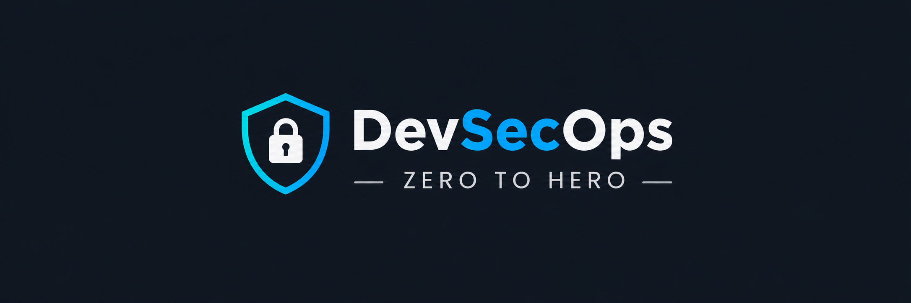
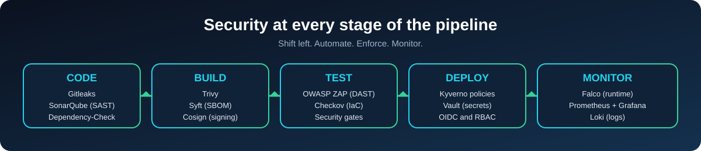

# 🛡️ DevSecOps Zero to Hero

**Learn. Secure. Automate. Deploy.**

A structured, hands-on learning repository for mastering DevSecOps by integrating security into the software development lifecycle, CI/CD pipelines, containers, Kubernetes, and infrastructure as code.

 

---

> [!NOTE]
> This repository is designed for learners who have already completed DevOps fundamentals, including Linux, Git, GitHub, Docker, Kubernetes, Terraform, Jenkins, GitHub Actions, Prometheus, and Grafana.

---

## 📚 Table of Contents
 
| # | Module | Key Tools |
| :---: | :--- | :--- |
| 01 | [DevSecOps Fundamentals](./01-devsecops-fundamentals/README.md) | Concepts, OWASP Top 10, Threat Modeling |
| 02 | [Linux Security](./02-linux-security/README.md) | SSH, sudo, Firewall, Auditing |
| 03 | [Git, GitHub and Secret Security](./03-git-github-and-secret-security/README.md) | Gitleaks |
| 04 | [Static Application Security Testing (SAST)](./04-static-application-security-testing-sast/README.md) | SonarQube |
| 05 | [Software Composition Analysis (SCA) and SBOM](./05-software-composition-analysis-sca-and-sbom/README.md) | OWASP Dependency-Check, Syft |
| 06 | [Dynamic Application Security Testing (DAST)](./06-dynamic-application-security-testing-dast/README.md) | OWASP ZAP |
| 07 | [Docker and Container Security](./07-docker-and-container-security/README.md) | Trivy, Syft, Cosign |
| 08 | [Kubernetes Security](./08-kubernetes-security/README.md) | Trivy, Kyverno, Falco |
| 09 | [Terraform and Infrastructure as Code Security](./09-terraform-and-infrastructure-as-code-security/README.md) | Checkov |
| 10 | [Jenkins and GitHub Actions Security](./10-jenkins-and-github-actions-security/README.md) | Gitleaks, SonarQube, Dependency-Check, Trivy |
| 11 | [Secrets Management and Cryptography](./11-secrets-management-and-cryptography/README.md) | HashiCorp Vault |
| 12 | [Security Monitoring, Incident Response and Capstone Project](./12-security-monitoring-incident-response-and-capstone-project/README.md) | Falco, Prometheus, Grafana, Loki, Trivy, Cosign, Checkov |
 
---

## 🛡️ Module Overview

### 01. DevSecOps Fundamentals

- DevOps vs. DevSecOps
- DevSecOps lifecycle
- Shift-left security
- Secure Software Development Life Cycle (SSDLC)
- Security gates in CI/CD pipelines
- OWASP Top 10 overview
- SAST, DAST, SCA, IaC scanning and container scanning
- Threat modeling fundamentals

### 02. Linux Security

- Linux security architecture and attack surface
- Users, groups, permissions and ACLs
- SUID, SGID and privilege escalation risks
- Linux capabilities and sudo security
- SSH hardening
- Firewall fundamentals
- Linux auditing and authentication logs
- Security baselines and vulnerability remediation

### 03. Git, GitHub and Secret Security

🔧 **Tool:** `Gitleaks`

- GitHub repository security
- Branch protection and pull request approvals
- Secret leakage in source code
- Scanning Git history for exposed credentials
- Secret remediation and rotation
- GitHub Actions permissions
- Secure third-party GitHub Actions usage
- Repository access control and least privilege

### 04. Static Application Security Testing (SAST)

🔧 **Tool:** `SonarQube`

- SAST fundamentals
- Static code analysis
- Identifying security vulnerabilities in source code
- Security rules and severity levels
- Vulnerability remediation
- False-positive management
- Security quality gates
- SonarQube integration with Jenkins and GitHub Actions

### 05. Software Composition Analysis (SCA) and SBOM

🔧 **Tools:** `OWASP Dependency-Check` · `Syft`

- Third-party dependency security
- Direct and transitive dependencies
- CVE, CWE and CVSS fundamentals
- Vulnerable dependency detection
- Dependency remediation
- Software Bill of Materials (SBOM)
- SBOM generation and analysis
- Dependency security gates in CI/CD

### 06. Dynamic Application Security Testing (DAST)

🔧 **Tool:** `OWASP ZAP`

- DAST fundamentals
- SAST vs. DAST
- OWASP Top 10 vulnerabilities
- SQL injection and cross-site scripting
- Authentication and authorization flaws
- API security testing
- Automated web application scanning
- DAST integration with CI/CD
- Vulnerability reports and remediation

### 07. Docker and Container Security

🔧 **Tools:** `Trivy` · `Syft` · `Cosign`

- Container security architecture
- Secure Dockerfile practices
- Non-root containers and least privilege
- Linux capabilities and container isolation
- Image vulnerability scanning with Trivy
- Base image security
- Software Bill of Materials generation
- Container image signing with Cosign
- Secure image publishing and verification
- Container security gates in CI/CD

### 08. Kubernetes Security

🔧 **Tools:** `Trivy` · `Kyverno` · `Falco`

- Kubernetes security architecture
- RBAC and least-privilege access
- Service account security
- Pod Security Standards
- Security contexts and Linux capabilities
- Kubernetes NetworkPolicies
- Secrets management fundamentals
- Admission control and policy enforcement
- Image vulnerability scanning
- Runtime threat detection with Falco
- Kubernetes security misconfiguration scanning

### 09. Terraform and Infrastructure as Code Security

🔧 **Tool:** `Checkov`

- Infrastructure as Code security
- Terraform security risks
- Detecting insecure resource configurations
- Hardcoded credentials and exposed secrets
- Publicly exposed cloud resources
- IAM misconfiguration risks
- Terraform security scanning with Checkov
- Security policies and compliance checks
- IaC scanning in CI/CD
- Preventing insecure infrastructure deployments

### 10. Jenkins and GitHub Actions Security

🔧 **Tools:** `Gitleaks` · `SonarQube` · `OWASP Dependency-Check` · `Trivy`

- CI/CD threat modeling
- Jenkins controller and agent security
- Jenkins credentials management
- GitHub Actions workflow permissions
- Secure third-party actions
- OpenID Connect (OIDC) for cloud authentication
- Pipeline injection risks
- Integrating secret scanning, SAST, SCA and container scanning
- Security gates and build failure conditions
- Secure artifact handling
- Protecting production deployment workflows

### 11. Secrets Management and Cryptography

🔧 **Tool:** `HashiCorp Vault`

- Secrets management fundamentals
- Symmetric and asymmetric encryption
- Hashing and digital signatures
- TLS and certificate fundamentals
- Secret storage and rotation
- Centralized secrets management
- HashiCorp Vault architecture
- Authentication and access policies
- Secure secret retrieval in CI/CD
- Preventing credentials from appearing in source code and logs

### 12. Security Monitoring, Incident Response and Capstone Project

🔧 **Tools:** `Falco` · `Prometheus` · `Grafana` · `Loki` · `Trivy` · `Cosign` · `Checkov`

#### 🚨 Security Monitoring and Incident Response

- Security logging and audit trails
- Runtime threat detection
- Monitoring suspicious container activity
- Security alerts and dashboards
- Incident investigation and root cause analysis
- Vulnerability remediation and reporting

#### 🏆 Capstone Project: End-to-End DevSecOps Pipeline

- Integrate Gitleaks for secret detection
- Integrate SonarQube for SAST
- Integrate OWASP Dependency-Check for dependency scanning
- Scan container images with Trivy
- Generate an SBOM using Syft
- Sign and verify images using Cosign
- Scan Terraform configurations using Checkov
- Enforce Kubernetes security policies using Kyverno
- Detect runtime threats using Falco
- Monitor security events using Prometheus, Grafana and Loki
- Implement security gates in Jenkins or GitHub Actions

---

## 🛠️ Tools Covered

| Security Area | Tool |
| :--- | :--- |
| 🔑 Secret Scanning | Gitleaks |
| 🧩 Static Application Security Testing | SonarQube |
| 📦 Software Composition Analysis | OWASP Dependency-Check |
| 🌐 Dynamic Application Security Testing | OWASP ZAP |
| 🐳 Container Security Scanning | Trivy |
| 📋 Software Bill of Materials | Syft |
| ✍️ Container Image Signing | Cosign |
| ☸️ Kubernetes Policy Enforcement | Kyverno |
| 👁️ Runtime Threat Detection | Falco |
| 🏗️ Infrastructure as Code Security | Checkov |
| 🔐 Secrets Management | HashiCorp Vault |
| 📈 Metrics Monitoring | Prometheus |
| 📊 Dashboards and Visualization | Grafana |
| 🗂️ Log Aggregation | Loki |

---

## 🎯 Learning Objectives

By completing this repository, learners will be able to:

- ✅ Integrate security into existing DevOps workflows.
- ✅ Identify and remediate source code vulnerabilities.
- ✅ Detect vulnerable dependencies and generate SBOMs.
- ✅ Build and distribute secure container images.
- ✅ Apply Kubernetes security policies and runtime protection.
- ✅ Identify insecure Terraform configurations before deployment.
- ✅ Secure Jenkins and GitHub Actions pipelines.
- ✅ Manage application secrets securely.
- ✅ Monitor security events and investigate incidents.
- ✅ Build an end-to-end DevSecOps pipeline with automated security gates.

---

## 🧪 Learning Approach

Each module will include:

| | |
| :--- | :--- |
| 📖 Concept explanations | 🔧 Tool installation and configuration |
| 🧑‍🔬 Step-by-step hands-on labs | 🌍 Real-world scenarios |
| 🐞 Troubleshooting exercises | 🛡️ Security best practices |
| 🚀 Practical implementation tasks | |

---

## 👨‍💻 Prerequisites

Learners should already have working knowledge of:

| | | | |
| :---: | :---: | :---: | :---: |
| 🐧 Linux | 🐙 Git and GitHub | 🐳 Docker | ☸️ Kubernetes |
| 🏗️ Terraform | 🔧 Jenkins | ⚙️ GitHub Actions | 📊 Prometheus and Grafana |

> [!TIP]
> This repository focuses on adding security capabilities to these existing DevOps skills rather than teaching the tools from scratch.

---

### Learn. Secure. Automate. Deploy. 🛡️

⭐ If you find this repository useful, consider giving it a star!

